<!--
  Every image below is a file in this repository. .github/workflows/profile.yml regenerates them daily.
  No external image service is used when the page is viewed
  (no capsule-render, readme-typing-svg, github-readme-stats, or skillicons.dev).
  External services are used only at build time, inside GitHub Actions:
    - yoshi389111/github-profile-3d-contrib (Action): profile-3d-contrib/*.svg
    - Platane/snk (Action): assets/generated/snake-*.svg
    - GitHub GraphQL API (scripts/build-svgs.mjs): assets/generated/status.svg, model/data/contrib.json
    - Spotify Web API (scripts/spotify.mjs, only when the SPOTIFY_* secrets exist): assets/generated/spotify.svg
  If one of them stops working, the workflow step fails or is skipped and the last committed image stays as it is
  (the page never shows a broken image because of an outage).
  The 3D GIFs (assets/model/) are original low-poly models (model/scenes/*.mjs) rendered on the CPU
  with `npm install` + `python model/render_cpu.py --scene <name>` (no browser, no GPU).
  Only github-city.gif is rebuilt by Actions (from the contribution calendar); the others are rendered by hand.
  Skill icons: assets/icons/skill-icons/ (tandpfun/skill-icons, MIT, see the LICENSE file there).
  To edit the one-liner, Kaggle link, certifications or the loadout, change profile.config.json.
  Blocks between the gen:NAME and /gen:NAME comment markers are rewritten by the scripts.
-->

  

  

  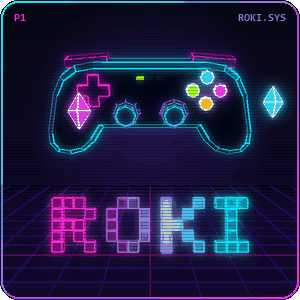
  

  

  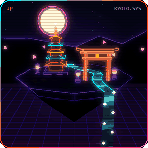
  <!-- gen:kaggle -->
<a href="https://www.kaggle.com/iwatahiroki">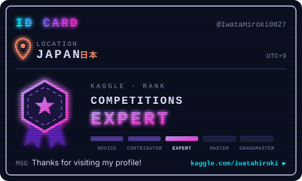</a>
<!-- /gen:kaggle -->

  

  <!-- gen:certs -->
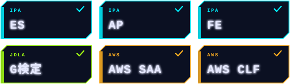
<!-- /gen:certs -->

  

  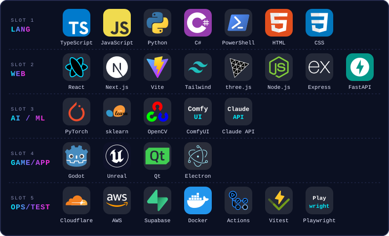

  

  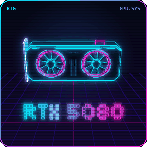
  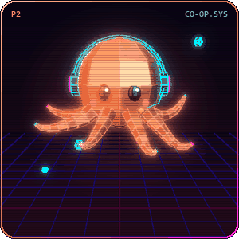

  

  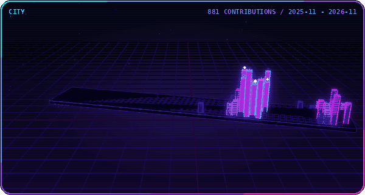

  

  

  

  <picture>
    <source media="(prefers-color-scheme: dark)" srcset="assets/generated/snake-dark.svg">
    <source media="(prefers-color-scheme: light)" srcset="assets/generated/snake-light.svg">
    
  </picture>

<!-- gen:spotify -->
<!-- Spotify is not connected yet: scripts/spotify.mjs shows this block once the SPOTIFY_* secrets are set. -->
<!-- /gen:spotify -->
