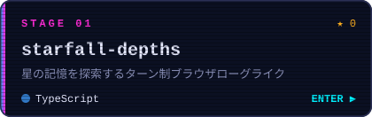
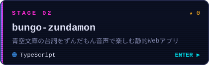
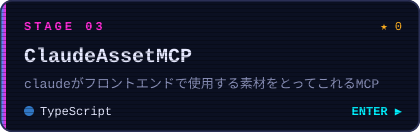
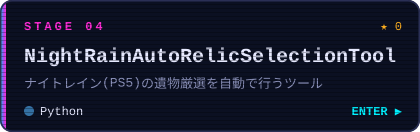
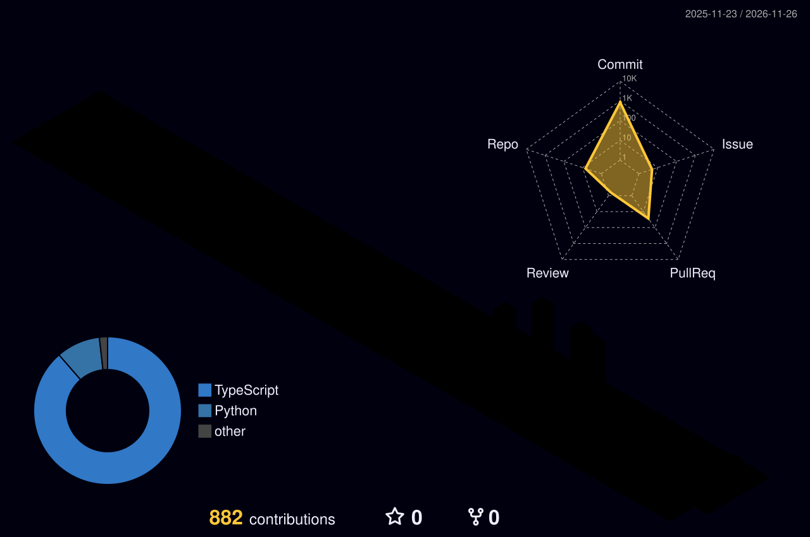

<!--
  Every image below is a file in this repository. .github/workflows/profile.yml regenerates them daily.
  No external image service is used when the page is viewed
  (no capsule-render, readme-typing-svg, or github-readme-stats).
  External services are used only at build time, inside GitHub Actions:
    - yoshi389111/github-profile-3d-contrib (Action): profile-3d-contrib/*.svg
    - Platane/snk (Action): assets/generated/snake-*.svg
    - GitHub GraphQL API (scripts/build-svgs.mjs): assets/generated/status.svg, stage-*.svg
  The 3D model GIF (assets/model/) is an original model (model/scene.mjs) rendered on the CPU with
  `npm install` + `python model/render_cpu.py` (no browser, no GPU). It is not regenerated by Actions.
  To edit the one-liner, the terminal lines, or the stage list, change profile.config.json.
-->

  

  

  

  
  

  

  
  
  
  

  

  

  

  <picture>
    <source media="(prefers-color-scheme: dark)" srcset="assets/generated/snake-dark.svg">
    <source media="(prefers-color-scheme: light)" srcset="assets/generated/snake-light.svg">
    
  </picture>

